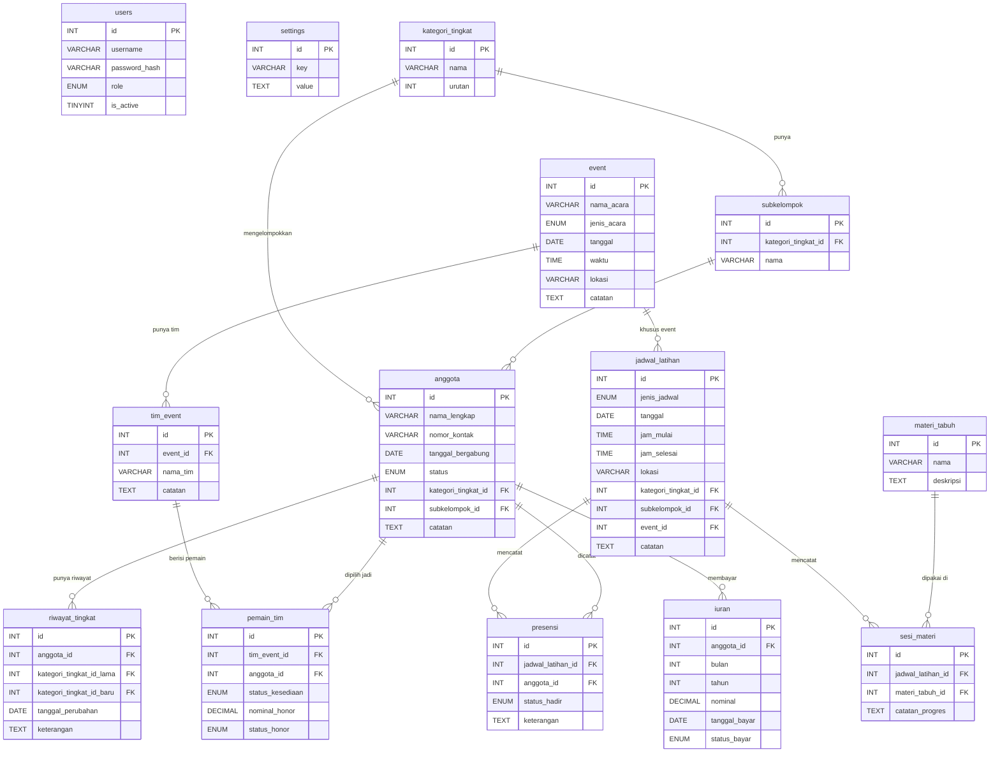
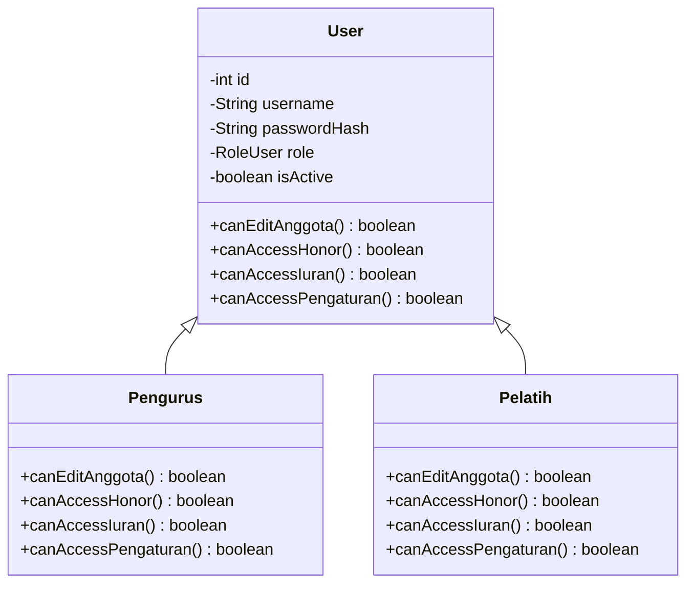
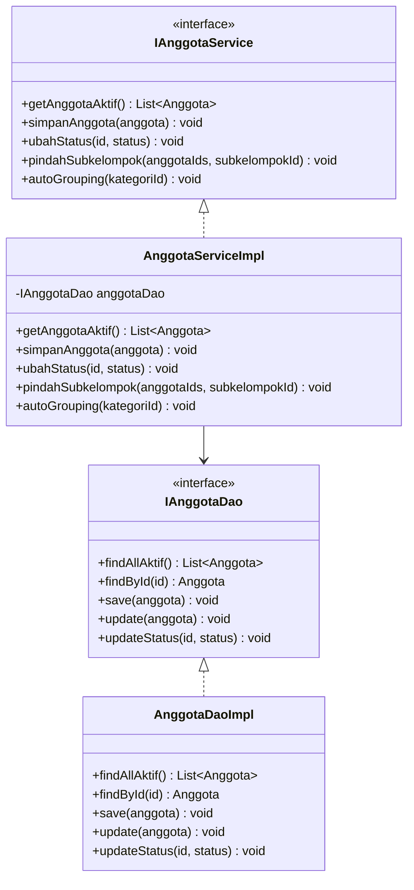
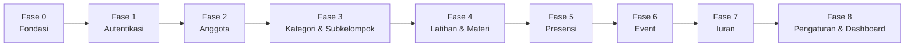

# Rancangan Teknis Aplikasi Pakem v1.0

> [!IMPORTANT]
> Dokumen ini adalah **rancangan awal** — belum ada file proyek atau kode yang dibuat.
> Implementasi dimulai setelah rancangan ini dikonfirmasi oleh pemilik proyek.

---

## 1. Rancangan Database MySQL (`schema.sql`)

### Diagram Relasi (ERD — ringkas)



---

### Daftar Tabel Lengkap

#### `users` — Akun pengguna aplikasi
| Kolom | Tipe | Keterangan |
|---|---|---|
| `id` | `INT UNSIGNED AUTO_INCREMENT` | PK |
| `username` | `VARCHAR(50) NOT NULL UNIQUE` | Username login |
| `password_hash` | `VARCHAR(255) NOT NULL` | Hash bcrypt |
| `role` | `ENUM('PENGURUS','PELATIH') NOT NULL` | Peran |
| `is_active` | `TINYINT(1) DEFAULT 1` | Soft-disable akun |
| `created_at` | `DATETIME DEFAULT CURRENT_TIMESTAMP` | |

---

#### `settings` — Konfigurasi sanggar
| Kolom | Tipe | Keterangan |
|---|---|---|
| `id` | `INT UNSIGNED AUTO_INCREMENT` | PK |
| `setting_key` | `VARCHAR(100) NOT NULL UNIQUE` | Contoh: `nama_sanggar`, `iuran_default`, `batas_kuning`, `batas_merah`, `kapasitas_kelompok` |
| `setting_value` | `TEXT NOT NULL` | Nilai dalam bentuk teks |

> [!NOTE]
> Disimpan sebagai key-value agar fleksibel tanpa perlu ALTER TABLE saat menambah setting baru.

---

#### `kategori_tingkat` — Master kategori tingkat (tidak di-hardcode)
| Kolom | Tipe | Keterangan |
|---|---|---|
| `id` | `INT UNSIGNED AUTO_INCREMENT` | PK |
| `nama` | `VARCHAR(100) NOT NULL UNIQUE` | Contoh: Dasar, Madya, Purna |
| `urutan` | `INT NOT NULL DEFAULT 0` | Urutan tampil (asc) |

---

#### `subkelompok` — Sub-grup di dalam kategori tingkat
| Kolom | Tipe | Keterangan |
|---|---|---|
| `id` | `INT UNSIGNED AUTO_INCREMENT` | PK |
| `kategori_tingkat_id` | `INT UNSIGNED NOT NULL` | FK → `kategori_tingkat.id` |
| `nama` | `VARCHAR(100) NOT NULL` | Contoh: Madya A, Madya B |
| `UNIQUE` | `(kategori_tingkat_id, nama)` | Nama unik per kategori |

---

#### `anggota` — Data anggota sanggar
| Kolom | Tipe | Keterangan |
|---|---|---|
| `id` | `INT UNSIGNED AUTO_INCREMENT` | PK |
| `nama_lengkap` | `VARCHAR(150) NOT NULL` | |
| `nomor_kontak` | `VARCHAR(20) NULL` | Opsional |
| `tanggal_bergabung` | `DATE NOT NULL` | |
| `status` | `ENUM('AKTIF','VAKUM','NONAKTIF') NOT NULL DEFAULT 'AKTIF'` | |
| `kategori_tingkat_id` | `INT UNSIGNED NULL` | FK → `kategori_tingkat.id`, SET NULL saat kategori dihapus |
| `subkelompok_id` | `INT UNSIGNED NULL` | FK → `subkelompok.id`, SET NULL saat subkelompok dihapus |
| `catatan` | `TEXT NULL` | Catatan bebas |
| `created_at` | `DATETIME DEFAULT CURRENT_TIMESTAMP` | |
| `updated_at` | `DATETIME DEFAULT CURRENT_TIMESTAMP ON UPDATE CURRENT_TIMESTAMP` | |

---

#### `riwayat_tingkat` — Arsip perubahan tingkat anggota
| Kolom | Tipe | Keterangan |
|---|---|---|
| `id` | `INT UNSIGNED AUTO_INCREMENT` | PK |
| `anggota_id` | `INT UNSIGNED NOT NULL` | FK → `anggota.id` |
| `kategori_tingkat_id_lama` | `INT UNSIGNED NULL` | FK → `kategori_tingkat.id` (nullable jika awal bergabung) |
| `kategori_tingkat_id_baru` | `INT UNSIGNED NULL` | FK → `kategori_tingkat.id` |
| `tanggal_perubahan` | `DATE NOT NULL` | |
| `keterangan` | `TEXT NULL` | Alasan / catatan perubahan |

---

#### `materi_tabuh` — Master repertoar/materi tabuh
| Kolom | Tipe | Keterangan |
|---|---|---|
| `id` | `INT UNSIGNED AUTO_INCREMENT` | PK |
| `nama` | `VARCHAR(200) NOT NULL UNIQUE` | Nama materi/gending |
| `deskripsi` | `TEXT NULL` | |

---

#### `event` — Pertunjukan / acara
| Kolom | Tipe | Keterangan |
|---|---|---|
| `id` | `INT UNSIGNED AUTO_INCREMENT` | PK |
| `nama_acara` | `VARCHAR(200) NOT NULL` | |
| `jenis_acara` | `ENUM('JOB','NGAYAH','UJIAN') NOT NULL` | |
| `tanggal` | `DATE NOT NULL` | |
| `waktu` | `TIME NULL` | |
| `lokasi` | `VARCHAR(255) NULL` | |
| `catatan` | `TEXT NULL` | |

---

#### `tim_event` — Tim dalam satu event (satu event bisa punya banyak tim)
| Kolom | Tipe | Keterangan |
|---|---|---|
| `id` | `INT UNSIGNED AUTO_INCREMENT` | PK |
| `event_id` | `INT UNSIGNED NOT NULL` | FK → `event.id` |
| `nama_tim` | `VARCHAR(100) NOT NULL` | Contoh: Tim A, Tim Madya |
| `catatan` | `TEXT NULL` | |

---

#### `pemain_tim` — Anggota yang dipilih untuk tim event
| Kolom | Tipe | Keterangan |
|---|---|---|
| `id` | `INT UNSIGNED AUTO_INCREMENT` | PK |
| `tim_event_id` | `INT UNSIGNED NOT NULL` | FK → `tim_event.id` |
| `anggota_id` | `INT UNSIGNED NOT NULL` | FK → `anggota.id` |
| `status_kesediaan` | `ENUM('BELUM_DITANYA','BERSEDIA','TIDAK_BERSEDIA') NOT NULL DEFAULT 'BELUM_DITANYA'` | |
| `nominal_honor` | `DECIMAL(12,2) NULL` | Hanya relevan jika jenis_acara = JOB |
| `status_honor` | `ENUM('BELUM_DIBAGIKAN','SUDAH_DIBAGIKAN') NULL` | Hanya relevan jika jenis_acara = JOB |
| `UNIQUE` | `(tim_event_id, anggota_id)` | Satu anggota sekali per tim |

---

#### `jadwal_latihan` — Sesi jadwal latihan
| Kolom | Tipe | Keterangan |
|---|---|---|
| `id` | `INT UNSIGNED AUTO_INCREMENT` | PK |
| `jenis_jadwal` | `ENUM('RUTIN','KHUSUS_EVENT') NOT NULL` | |
| `tanggal` | `DATE NOT NULL` | |
| `jam_mulai` | `TIME NULL` | |
| `jam_selesai` | `TIME NULL` | |
| `lokasi` | `VARCHAR(255) NULL` | |
| `kategori_tingkat_id` | `INT UNSIGNED NULL` | FK → `kategori_tingkat.id` (untuk latihan RUTIN) |
| `subkelompok_id` | `INT UNSIGNED NULL` | FK → `subkelompok.id` (opsional, bisa null = seluruh kategori) |
| `event_id` | `INT UNSIGNED NULL` | FK → `event.id` (untuk latihan KHUSUS_EVENT) |
| `catatan` | `TEXT NULL` | |

> [!NOTE]
> Latihan `RUTIN` menggunakan `kategori_tingkat_id` / `subkelompok_id`. Latihan `KHUSUS_EVENT` menggunakan `event_id` dan mengandalkan daftar pemain dari `pemain_tim`.

---

#### `sesi_materi` — Materi yang dikerjakan + catatan progres per sesi
| Kolom | Tipe | Keterangan |
|---|---|---|
| `id` | `INT UNSIGNED AUTO_INCREMENT` | PK |
| `jadwal_latihan_id` | `INT UNSIGNED NOT NULL` | FK → `jadwal_latihan.id` |
| `materi_tabuh_id` | `INT UNSIGNED NOT NULL` | FK → `materi_tabuh.id` |
| `catatan_progres` | `TEXT NULL` | Catatan progres sesi ini |

> [!TIP]
> Untuk fitur "sambung progres terakhir": query `sesi_materi` ORDER BY `jadwal_latihan.tanggal` DESC, filter berdasarkan materi dan kelompok yang sama, ambil baris pertama.

---

#### `presensi` — Catatan kehadiran per sesi
| Kolom | Tipe | Keterangan |
|---|---|---|
| `id` | `INT UNSIGNED AUTO_INCREMENT` | PK |
| `jadwal_latihan_id` | `INT UNSIGNED NOT NULL` | FK → `jadwal_latihan.id` |
| `anggota_id` | `INT UNSIGNED NOT NULL` | FK → `anggota.id` |
| `status_hadir` | `ENUM('HADIR','IZIN','SAKIT','TANPA_KETERANGAN') NOT NULL` | |
| `keterangan` | `TEXT NULL` | Catatan opsional |
| `UNIQUE` | `(jadwal_latihan_id, anggota_id)` | Satu anggota sekali per sesi |

---

#### `iuran` — Pencatatan pembayaran iuran bulanan
| Kolom | Tipe | Keterangan |
|---|---|---|
| `id` | `INT UNSIGNED AUTO_INCREMENT` | PK |
| `anggota_id` | `INT UNSIGNED NOT NULL` | FK → `anggota.id` |
| `bulan` | `TINYINT UNSIGNED NOT NULL` | 1–12 |
| `tahun` | `SMALLINT UNSIGNED NOT NULL` | Contoh: 2026 |
| `nominal` | `DECIMAL(12,2) NULL` | Nominal aktual yang dibayar |
| `tanggal_bayar` | `DATE NULL` | NULL = belum bayar |
| `status_bayar` | `ENUM('BELUM_BAYAR','LUNAS') NOT NULL DEFAULT 'BELUM_BAYAR'` | |
| `UNIQUE` | `(anggota_id, bulan, tahun)` | Satu record per anggota per bulan |

> [!NOTE]
> Warna indikator (Putih/Kuning/Merah/Hijau) dihitung di **ServiceLayer** saat runtime berdasarkan `tanggal_bayar`, tanggal hari ini, dan nilai `batas_kuning`/`batas_merah` dari tabel `settings`. Tidak perlu kolom tambahan.

---

## 2. Rancangan Arsitektur & Class Java

### Struktur Package

```
com.pakem
├── Main.java                        ← Entry point, inisialisasi FlatLaf & DB
│
├── config/
│   └── DatabaseConfig.java          ← Singleton koneksi JDBC (HikariCP ringan)
│
├── model/                           ← POJO / domain object (Encapsulation)
│   ├── User.java
│   ├── Anggota.java
│   ├── KategoriTingkat.java
│   ├── Subkelompok.java
│   ├── RiwayatTingkat.java
│   ├── MateriTabuh.java
│   ├── JadwalLatihan.java
│   ├── SesiMateri.java
│   ├── Presensi.java
│   ├── Event.java
│   ├── TimEvent.java
│   ├── PemainTim.java
│   ├── Iuran.java
│   └── enums/
│       ├── StatusAnggota.java       ← AKTIF, VAKUM, NONAKTIF
│       ├── RoleUser.java            ← PENGURUS, PELATIH
│       ├── JenisAcara.java          ← JOB, NGAYAH, UJIAN
│       ├── JenisJadwal.java         ← RUTIN, KHUSUS_EVENT
│       ├── StatusHadir.java         ← HADIR, IZIN, SAKIT, TANPA_KETERANGAN
│       ├── StatusKesediaan.java     ← BELUM_DITANYA, BERSEDIA, TIDAK_BERSEDIA
│       └── StatusHonor.java         ← BELUM_DIBAGIKAN, SUDAH_DIBAGIKAN
│
├── dao/                             ← Abstraction: kontrak akses data
│   ├── interfaces/                  ← Interface DAO (Abstraction)
│   │   ├── IUserDao.java
│   │   ├── IAnggotaDao.java
│   │   ├── IKategoriTingkatDao.java
│   │   ├── ISubkelompokDao.java
│   │   ├── IMateriTabuhDao.java
│   │   ├── IJadwalLatihanDao.java
│   │   ├── ISesiMateriDao.java
│   │   ├── IPresensiDao.java
│   │   ├── IEventDao.java
│   │   ├── ITimEventDao.java
│   │   ├── IPemainTimDao.java
│   │   ├── IIuranDao.java
│   │   └── ISettingsDao.java
│   │
│   └── impl/                        ← Implementasi JDBC konkret
│       ├── UserDaoImpl.java
│       ├── AnggotaDaoImpl.java
│       ├── KategoriTingkatDaoImpl.java
│       ├── SubkelompokDaoImpl.java
│       ├── MateriTabuhDaoImpl.java
│       ├── JadwalLatihanDaoImpl.java
│       ├── SesiMateriDaoImpl.java
│       ├── PresensiDaoImpl.java
│       ├── EventDaoImpl.java
│       ├── TimEventDaoImpl.java
│       ├── PemainTimDaoImpl.java
│       ├── IuranDaoImpl.java
│       └── SettingsDaoImpl.java
│
├── service/                         ← Business logic (Abstraction via interface)
│   ├── interfaces/
│   │   ├── IAuthService.java
│   │   ├── IAnggotaService.java
│   │   ├── IKategoriService.java
│   │   ├── ILatihanService.java
│   │   ├── IPresensiService.java
│   │   ├── IEventService.java
│   │   ├── IIuranService.java
│   │   └── IDashboardService.java
│   │
│   └── impl/
│       ├── AuthServiceImpl.java
│       ├── AnggotaServiceImpl.java
│       ├── KategoriServiceImpl.java
│       ├── LatihanServiceImpl.java
│       ├── PresensiServiceImpl.java
│       ├── EventServiceImpl.java
│       ├── IuranServiceImpl.java     ← hitung indikator warna di sini
│       └── DashboardServiceImpl.java
│
└── ui/                              ← Java Swing Views
    ├── MainFrame.java               ← JFrame utama, card layout / panel switching
    ├── LoginPanel.java
    ├── DashboardPanel.java
    ├── anggota/
    │   ├── AnggotaListPanel.java
    │   ├── AnggotaFormDialog.java
    │   └── RiwayatTingkatDialog.java
    ├── kategori/
    │   ├── KategoriTingkatPanel.java
    │   └── SubkelompokDialog.java
    ├── latihan/
    │   ├── JadwalLatihanPanel.java
    │   ├── JadwalLatihanFormDialog.java
    │   ├── MateriTabuhPanel.java
    │   └── SesiMateriDialog.java
    ├── presensi/
    │   ├── PresensiPanel.java
    │   └── RekapPresensiPanel.java
    ├── event/
    │   ├── EventListPanel.java
    │   ├── EventFormDialog.java
    │   ├── TimEventPanel.java
    │   └── PemainTimDialog.java
    ├── iuran/
    │   └── IuranPanel.java
    └── pengaturan/
        └── PengaturanPanel.java
```

---

### Penerapan Prinsip PBO

#### Encapsulation — `model/`
Semua field `private`, diakses via getter/setter. Tidak ada field `public`.

```java
// Contoh: Anggota.java
public class Anggota {
    private int id;
    private String namaLengkap;
    private StatusAnggota status;
    // ... getter & setter
}
```

---

#### Inheritance & Polymorphism — Hierarki Pengguna



> [!NOTE]
> `MainFrame` memanggil `currentUser.canAccessHonor()` untuk memutuskan apakah tab/panel honor ditampilkan — itulah **Polymorphism** nyata sesuai kebutuhan PRD tanpa over-engineering.

---

#### Abstraction — Interface DAO & Service



---

## 3. Rencana Pengerjaan Bertahap

### Fase 0 — Fondasi Proyek
| # | Tugas | Output |
|---|---|---|
| 0.1 | Buat `pom.xml` (Java 25, FlatLaf, MySQL Connector/J) | `pom.xml` |
| 0.2 | Buat `.gitignore` standar Java/Maven | `.gitignore` |
| 0.3 | Buat `schema.sql` (semua tabel sesuai rancangan di atas) | `schema.sql` |
| 0.4 | Buat `DatabaseConfig.java` (singleton JDBC) + koneksi awal | `config/` |
| 0.5 | Buat semua `model/` class + `enums/` | `model/` |
| 0.6 | Buat `Main.java` (inisialisasi FlatLaf, buka LoginPanel) | `Main.java` |
| 0.7 | Buat `PROGRESS.md` awal | `PROGRESS.md` |

**Kriteria selesai:** Proyek `mvn compile` tanpa error, koneksi DB berhasil di-test.

---

### Fase 1 — Autentikasi (P0)
| # | Tugas | Output |
|---|---|---|
| 1.1 | `IUserDao` + `UserDaoImpl` (findByUsername) | DAO |
| 1.2 | `IAuthService` + `AuthServiceImpl` (login, hash password) | Service |
| 1.3 | `LoginPanel` (form username/password, tombol Login) | UI |
| 1.4 | Hierarki `User → Pengurus / Pelatih` + method hak akses | Model |
| 1.5 | `MainFrame` skeleton dengan panel switching | UI |

**Kriteria selesai:** Login berhasil membedakan peran; menu yang tidak diizinkan tersembunyi.

---

### Fase 2 — Manajemen Anggota (P0)
| # | Tugas | Output |
|---|---|---|
| 2.1 | `IAnggotaDao` + `AnggotaDaoImpl` | DAO |
| 2.2 | `IAnggotaService` + `AnggotaServiceImpl` | Service |
| 2.3 | `AnggotaListPanel` (tabel anggota, filter status) | UI |
| 2.4 | `AnggotaFormDialog` (tambah/ubah anggota) | UI |
| 2.5 | Simpan riwayat tingkat saat kategori diubah | Service |
| 2.6 | `RiwayatTingkatDialog` (lihat riwayat) | UI |

**Kriteria selesai:** CRUD anggota berjalan; ubah status = hilang dari daftar aktif; riwayat tingkat tersimpan.

---

### Fase 3 — Kategori Tingkat & Subkelompok (P0)
| # | Tugas | Output |
|---|---|---|
| 3.1 | `IKategoriTingkatDao` + impl, `ISubkelompokDao` + impl | DAO |
| 3.2 | `IKategoriService` + impl (termasuk auto-grouping) | Service |
| 3.3 | `KategoriTingkatPanel` + `SubkelompokDialog` | UI |
| 3.4 | Dialog konfirmasi sebelum auto-grouping menimpa | UI |

**Kriteria selesai:** Tambah/hapus kategori bisa; auto-grouping merata; pemindahan manual berfungsi; indikator kapasitas tampil.

---

### Fase 4 — Jadwal Latihan & Materi Tabuh (P0)
| # | Tugas | Output |
|---|---|---|
| 4.1 | `IMateriTabuhDao` + impl | DAO |
| 4.2 | `IJadwalLatihanDao` + `ISesiMateriDao` + impl | DAO |
| 4.3 | `ILatihanService` + impl (termasuk query progres terakhir) | Service |
| 4.4 | `MateriTabuhPanel`, `JadwalLatihanPanel`, `JadwalLatihanFormDialog` | UI |
| 4.5 | `SesiMateriDialog` (pilih materi + isi catatan progres, tampilkan catatan sebelumnya) | UI |
| 4.6 | Tombol "Salin Pengumuman" ke clipboard | UI |

**Kriteria selesai:** Jadwal dibuat; sesi materi dicatat; catatan progres sesi terakhir muncul di sesi berikutnya; salin clipboard berfungsi.

---

### Fase 5 — Presensi (P0)
| # | Tugas | Output |
|---|---|---|
| 5.1 | `IPresensiDao` + impl | DAO |
| 5.2 | `IPresensiService` + impl | Service |
| 5.3 | `PresensiPanel` (pilih jadwal → daftar anggota aktif → input status) | UI |
| 5.4 | `RekapPresensiPanel` (tabel rekap + persentase per anggota) | UI |

**Kriteria selesai:** Presensi tercatat; anggota Vakum/Nonaktif tidak muncul; rekap persentase akurat.

---

### Fase 6 — Pertunjukan / Event (P0)
| # | Tugas | Output |
|---|---|---|
| 6.1 | `IEventDao`, `ITimEventDao`, `IPemainTimDao` + impl | DAO |
| 6.2 | `IEventService` + impl | Service |
| 6.3 | `EventListPanel`, `EventFormDialog` | UI |
| 6.4 | `TimEventPanel` (manajemen tim dalam event) | UI |
| 6.5 | `PemainTimDialog` (pilih anggota aktif lintas tingkat, catat kesediaan) | UI |
| 6.6 | Panel honor (hanya tampil jika jenis = JOB, hanya untuk Pengurus) | UI |
| 6.7 | Tombol "Salin Info Acara & Pemain" ke clipboard | UI |

**Kriteria selesai:** Multi-tim per event berfungsi; kolom honor tampil/tersembunyi sesuai jenis acara dan peran; salin clipboard berfungsi.

---

### Fase 7 — Iuran Bulanan (P0)
| # | Tugas | Output |
|---|---|---|
| 7.1 | `IIuranDao` + impl | DAO |
| 7.2 | `IIuranService` + impl (hitung status warna berdasarkan settings) | Service |
| 7.3 | `IuranPanel` (pilih bulan/tahun → daftar anggota aktif + warna indikator) | UI |

**Kriteria selesai:** Daftar tagihan hanya anggota Aktif; warna indikator berubah dinamis sesuai tanggal dan settings; catat bayar berfungsi.

---

### Fase 8 — Pengaturan Sanggar & Dashboard (P1)
| # | Tugas | Output |
|---|---|---|
| 8.1 | `ISettingsDao` + impl | DAO |
| 8.2 | `PengaturanPanel` (edit nama sanggar, nominal iuran, batas kuning/merah, kapasitas) | UI |
| 8.3 | `IDashboardService` + impl (query ringkasan) | Service |
| 8.4 | `DashboardPanel` (jumlah anggota, jadwal terdekat, rekap iuran, rekap presensi bulan ini) | UI |

**Kriteria selesai:** Ubah batas tanggal di Pengaturan langsung memperbarui warna iuran; Dashboard menampilkan data ringkasan akurat.

---

### Ringkasan Urutan & Dependensi



---

> [!TIP]
> Setelah setiap fase selesai, file `PROGRESS.md` di root proyek akan diperbarui secara otomatis dengan ringkasan modul selesai, class penting yang dibuat, dan tugas fase berikutnya.
